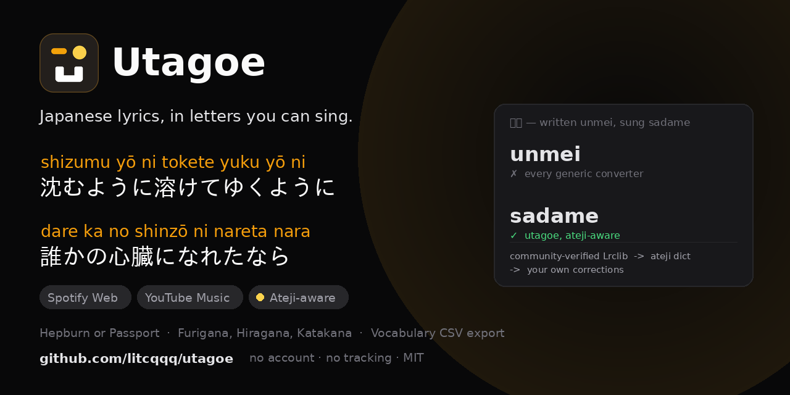
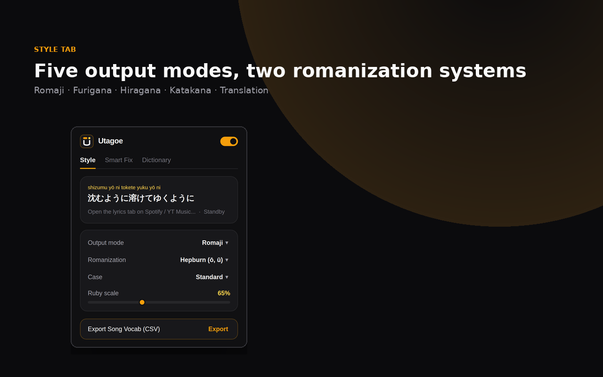
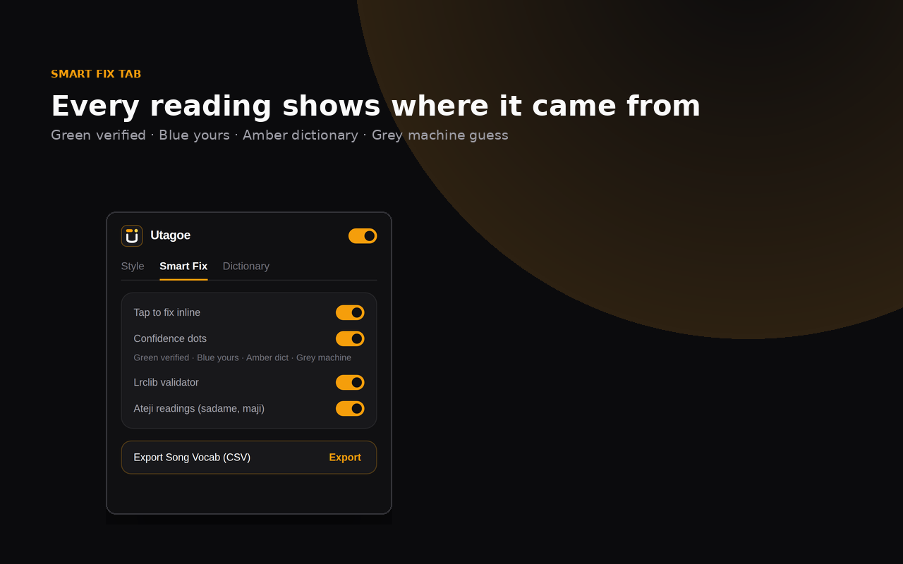
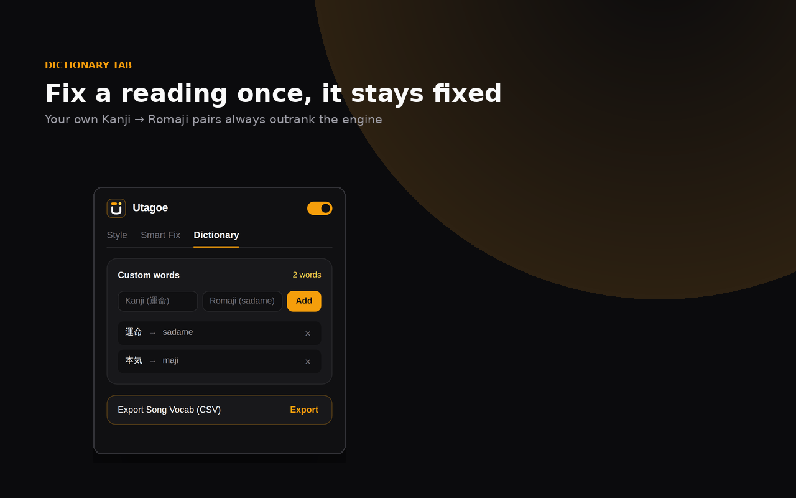
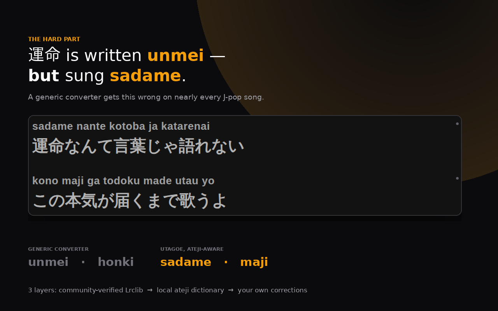

# Utagoe — Japanese lyrics in Romaji for Spotify and YouTube Music

[](https://github.com/litcqqq/utagoe/releases/latest)
[](https://github.com/litcqqq/utagoe/actions)
[](LICENSE)
[](https://developer.chrome.com/docs/extensions/develop/migrate)
[](#install)



**Karaoke for people who can't read Kanji yet.** Utagoe shows **Romaji directly above the original Japanese lyric line** on **Spotify Web Player** and **YouTube Music**, so you sing along instead of staring at characters you can't pronounce.

The reason most romaji extensions let you down is **ateji (当て字)** — songwriters routinely write one Kanji and sing a completely different word. 運命 is written *unmei* but sung *sadame*. 本気 is written *honki* but sung *maji*. A dictionary converter gets both wrong. Utagoe resolves every line through **three layers** instead.



## Why this one instead of the others

| | Utagoe | Typical romaji extension |
|---|---|---|
| Ateji-aware readings | ✅ 3-layer resolution | ❌ morphological guess only |
| Where a reading came from | ✅ colour-coded per line | ❌ no signal |
| Fix a wrong reading | ✅ tap the word, saved forever | ❌ impossible |
| Furigana / Hiragana / Katakana | ✅ all three, switchable | ⚠️ usually romaji only |
| Vocabulary export for Anki | ✅ one-click CSV | ❌ none |
| Account, tracking, analytics | ✅ none | ⚠️ varies |
| Runs offline after install | ✅ local engine | ⚠️ often server-based |

Free, open source, no account. The dictionary runs on your machine; nothing about your listening is sent anywhere.

## Install

**No Node.js, no build step.** Download the zip from the [latest release](https://github.com/litcqqq/utagoe/releases/latest), unzip it, and load it unpacked.

### Chrome / Brave / Opera / Vivaldi
1. Download `utagoe-vX.Y.Z.zip` from the latest release.
2. Unzip it anywhere. You should see `manifest.json` sitting directly inside the folder — not nested one level deeper.
3. Open `chrome://extensions/`.
4. Turn on **Developer mode** (top-right).
5. Click **Load unpacked** (top-left) and select the unzipped folder.
6. Pin Utagoe from the puzzle-piece menu so the popup is one click away.

### Microsoft Edge
1. Open `edge://extensions/`.
2. Turn on **Developer mode** (bottom-left panel).
3. Click **Load unpacked** and select the unzipped folder.

### Updating
Download the new zip, unzip it over the old folder, then press **Reload** on the extension card in `chrome://extensions/`.

### Then
Open **Spotify Web Player** or **YouTube Music**, play any Japanese song, and open the **Lyrics** view. Romaji appears above each line immediately.

---

## Building from source

Only needed if you want to modify the extension.

```bash
git clone https://github.com/litcqqq/utagoe.git
cd utagoe
npm install
npm run build   # produces dist/, ready to load unpacked
npm test        # verification suite
```

The build copies the Kuromoji dictionary out of `node_modules/kuromoji/dict/` into `dist/dict/`, prepares the library files, generates the PNG icons, and copies the manifest, content scripts, service worker, and popup. `dist/` is the folder you load into the browser.

`dist/dict/` is gitignored: it is ~17 MB of dictionary data that is regenerated on every build. A fresh clone has no `dist/dict/` until you run `npm run build`.

---

## Releasing

Releases are built by GitHub Actions from a tag, so nobody has to trust a zip committed to the repository.

```bash
# 1. Bump the version in BOTH package.json and src/manifest.json
# 2. Commit, then tag and push
git tag v1.0.1
git push origin v1.0.1
```

The [`Release`](.github/workflows/release.yml) workflow then installs dependencies, builds, runs the test suite, packages `dist/` into `utagoe-v1.0.1.zip`, and attaches it to a new GitHub Release.

The workflow refuses to publish if:

- the tag does not match the version in `src/manifest.json` — this prevents shipping a zip whose manifest disagrees with its label;
- `manifest.json` is not at the archive root — Chrome's *Load unpacked* cannot find a manifest nested in a subfolder;
- fewer than 10 `dict/*.dat.gz` files are present — the dictionary is gitignored, so a broken copy step would otherwise produce an extension that installs fine and then fails on every lyric with a dictionary fetch error.

To publish without pushing a tag, run the workflow manually from the Actions tab and supply the tag name.

---

## How it works

### The 3-layer validation engine

In Japanese music, artists frequently write one Kanji but sing a different reading: 運命 is written *unmei* but sung *sadame*, 本気 is written *honki* but sung *maji*, 未来 is written *mirai* but sung *asu*. A purely morphological converter gets all of these wrong. Utagoe therefore resolves each line through three layers, highest priority first:

1. **Community-verified lyrics (Lrclib API)**
   When a track starts, the extension queries Lrclib. If the community has uploaded human-verified Romaji lyrics, those are used, which guarantees the vocals and ateji match what is actually sung.
2. **Local ateji and particle dictionary**
   If the track is not in the community database, the local Kuroshiro engine takes over and corrects the Kanji words Japanese composers most often re-read (`運命 -> sadame`, `本気 -> maji`, `未来 -> asu`, `地球 -> hoshi`, and so on).
3. **Custom user dictionary**
   You can add your own Kanji-to-Romaji pairs from the popup. These are stored permanently in the browser and always win.

### Features

- **Stacked two-line display:** the Romaji sits proportionally above the original Kanji/Kana so the Japanese lyrics stay readable.
- **Four display modes:** Romaji, **furigana** (ruby readings over the Kanji), Hiragana, or Katakana — switchable from the popup.
- **Tap a word to fix its reading:** every word is individually addressable. Tapping opens an inline editor, and the corrected reading is saved to your personal dictionary and used everywhere from then on.
- **Reading confidence dots:** each line carries a dot telling you where its reading came from — green for community-verified lyrics, blue for your own corrections, amber for the ateji dictionary, grey for a machine guess.
- **Translation mode:** swap each lyric line in place for a translation — English, Thai, Chinese, Indonesian, Korean, Spanish, Vietnamese, French, German, or Portuguese — with no extra row and no change to the layout.
- **Vocabulary export:** one click exports every Kanji word in the current song to a CSV (word, kana, romaji, source line, song) for Anki or a spreadsheet.
- **Conjugation-aware readings:** conjugated verbs are read as words, not fragments — 溶けてゆく is *tokete yuku*, not *toke te yuku*.
- **Validation badge:** shows whether the current track is using `[Verified (Lrclib)]` or `[Morphological transliteration]` lyrics.
- **Click-to-seek preserved:** clicking a lyric line still jumps to that timestamp in the Spotify player.
- **Karaoke colouring:** follows Spotify's active-line marker in real time.
- **Interactive settings popup**, split into three tabs so no view scrolls:
  - **Style** — live lyric preview, output mode (Romaji, Furigana, Hiragana, Katakana, or a translation language), romanization system (**Hepburn** with the macrons *ō*, *ū*, or **Passport** plain ASCII), letter case, and the Romaji font-size ratio (50%–90%).
  - **Smart Fix** — tap-to-fix, confidence dots, the Lrclib validator, and the ateji dictionary.
  - **Dictionary** — your own Kanji-to-Romaji corrections.
  - A **CSV vocabulary export** bar pinned below the tabs, and a master on/off toggle in the header.

### The three popup tabs

Every reading in the app is accountable: it tells you whether it came from a human-verified lyric sheet, the ateji dictionary, your own correction, or a machine guess.




### When a generic converter is wrong



---

## Usage on Spotify Web

1. Open [Spotify Web Player](https://open.spotify.com) and log in.
2. Play a Japanese song (for example *YOASOBI - 夜に駆ける*).
3. Click the **Lyrics** (microphone) button in the bottom-right of the player.
4. The Romaji appears immediately above each Kanji line:
   ```text
   shizumu yō ni tokete yuku yō ni      <-- Romaji on top
   沈むように溶けてゆくように           <-- original Kanji below
   ```
5. Open the extension popup to check the validation status or add a word correction.

## Usage on YouTube Music

1. Open [YouTube Music](https://music.youtube.com) and play a Japanese song.
2. Open the track page and click the **Lyrics** tab in the side panel. The tab must be opened first, because the page only renders the lyric container once that tab is activated.
3. Each Japanese line is automatically rendered stacked, Romaji on top and the original text below.
4. On track change the extension rescans automatically (the `yt-navigate-finish` hook, a click on the Lyrics tab, a `MutationObserver`, and a 1.5-second poll). If the **Lyrics** tab gets closed or the lyrics have not appeared yet, reopen the tab.

---

## FAQ

**Does it work with the Spotify desktop app or the mobile app?**
No. Utagoe targets the **web players** only — `open.spotify.com` and `music.youtube.com` in a desktop browser. Spotify's desktop client is not a browser extension host.

**Do I need Spotify Premium?**
No. Free and Premium both show lyrics in the web player, and Utagoe only reads what is already on screen.

**Does it need an internet connection?**
Only for two optional things: the Lrclib lookup (community-verified lyrics) and translation mode. The romaji engine and its dictionary are bundled and run locally, so basic romanization works offline after install.

**Why is a reading wrong on one song?**
Because ateji is not a rule, it is an artistic choice — 未来 can be *mirai* or *asu* depending on the song. That is exactly why every line carries a confidence dot and every word is tappable. Tap it, type the right reading, and it is saved for good.

**Does it send my listening data anywhere?**
No account, no analytics, no telemetry. The only outbound requests are the track title and artist to Lrclib, and lyric text to Google Translate **only if** you switch to translation mode.

**Where is the Chrome Web Store listing?**
Not published yet — Utagoe is distributed as a release zip you load unpacked. Store review is in progress; the zip install is identical to what the store would ship.

**Can I use it in Firefox?**
Not yet. The code targets Manifest V3 on Chromium browsers (Chrome, Edge, Brave, Opera, Vivaldi). A Firefox port needs the `browser.*` namespace and a `background.scripts` fallback.

**How do I contribute readings?**
Open the Dictionary tab and add the pair, then [open an issue](https://github.com/litcqqq/utagoe/issues/new) with the song and the reading — ateji corrections that generalise get folded into the bundled dictionary for everyone.

---

## Known limitations

- **Desktop web only** (`music.youtube.com`), not the YouTube Music desktop or mobile apps.
- Lyrics must actually exist on YouTube Music for that track; if a song has no lyrics there is nothing to romanize.
- **Click-to-seek** currently works on Spotify only, not on YouTube Music.
- YouTube Music's **full-screen** lyrics view uses a different component and is not styled; only the side-panel lyrics are supported.
- Track metadata is read from `ytmusic-track-info`, with the older `ytmusic-player-bar` layout supported as a fallback.

---

## Project structure

```
src/                       extension source (edited by hand)
  manifest.json            MV3 manifest
  content/
    content.js             scan loop, observers, render pipeline, tap-to-fix UI
    readings.js            token stream: kana, romaji, confidence, vocabulary
    translate.js           lyric translation with caching
    export.js              vocabulary CSV builder and downloader
    validator.js           Lrclib client, LRC parser, header stripping
    ateji.js               ateji rulebook and custom overrides
    sites/spotify.js       Spotify DOM adapter
    sites/youtubemusic.js  YouTube Music DOM adapter
  background/
    service-worker.js      cross-origin proxies (Lrclib, translation)
  popup/                   settings UI
build.js                   copies everything into dist/
test/verify-extension.js   packaging and contract checks
test/features-1.0.1.test.js  module-level feature checks
test/render-path.test.js   content-script render path against a stub DOM
test/browser-probe.js      loads the real extension in Chrome and renders a page
dist/                      build output — this is what you load into the browser
```

### Why the service worker exists

A content script inherits the page's origin, so a `fetch()` from a content script to `lrclib.net` is blocked by CORS even when the domain appears in `host_permissions`. `host_permissions` grants cross-origin access to the service worker and extension pages, not to content scripts. All Lrclib and translation traffic therefore goes through `chrome.runtime.sendMessage` to the service worker, which performs the actual request.

### Test suites

`npm test` runs the build, the packaging checks, the feature checks, and the render-path checks. `npm run test:browser` additionally launches a real Chrome with the built extension loaded and renders a synthetic lyrics page, which is the only check that proves the manifest is accepted and the scripts run in order.

## License

ISC — see [LICENSE](LICENSE). Utagoe is an independent project, not affiliated with Spotify or YouTube.

Bundled dependencies keep their own licences: [Kuroshiro](https://github.com/hexenq/kuroshiro) (MIT), [kuroshiro-analyzer-kuromoji](https://github.com/hexenq/kuroshiro-analyzer-kuromoji) (MIT), and the [Kuromoji](https://www.atilika.org/) dictionary (Apache-2.0).
